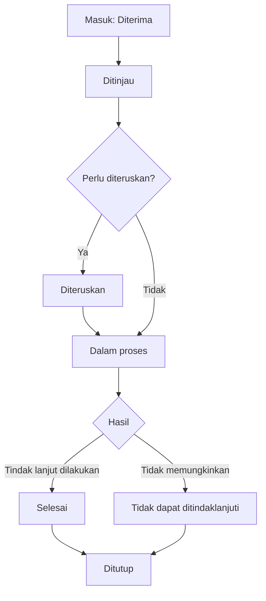
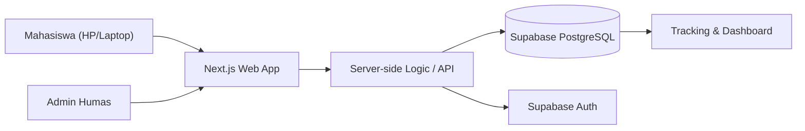

# SUARA TK --- Dokumentasi Perencanaan & Pengembangan Web App

**Suara Teknik Komputer**  
Slogan: *Dengar, Catat, Tindaklanjuti.*  
Program kerja berkelanjutan Humas HIMTEK  

---

## 1. Ringkasan Proyek

SUARA TK adalah web application yang menjadi kanal komunikasi aspirasi mahasiswa Teknik Komputer kepada HIMTEK dan/atau pihak terkait. Platform ini bertujuan menampung aspirasi, kritik, saran, ide kegiatan, serta laporan kendala dengan alur pengelolaan yang terstruktur, transparan, dan dapat dipertanggungjawabkan.

Web app dipilih karena dapat diakses melalui browser HP maupun laptop tanpa instalasi. Sistem dirancang responsif dan berpotensi dikembangkan menjadi Progressive Web App (PWA), sehingga dapat ditambahkan ke layar utama perangkat seperti aplikasi.

### Identitas
- **Nama:** SUARA TK
- **Kepanjangan:** Suara Teknik Komputer
- **Slogan:** Dengar, Catat, Tindaklanjuti.
- **Pelaksana:** Humas HIMTEK
- **Sasaran:** Mahasiswa Teknik Komputer lintas angkatan
- **Jenis:** Web-based application
- **Status dokumen:** Rencana pengembangan awal; keputusan teknis dapat disesuaikan setelah validasi kebutuhan dan kemampuan tim.

### Prinsip
1. **Accessible:** mudah diakses, terutama melalui HP.
2. **Transparent:** status dan tindak lanjut aspirasi jelas.
3. **Responsive:** setiap aspirasi mendapat proses dan respons yang layak.
4. **Private & Safe:** identitas dan data sensitif dilindungi.
5. **Sustainable:** dokumentasi, akses, dan prosedur dapat diwariskan antarperiode.

---

## 2. Latar Belakang

Komunikasi mahasiswa dan organisasi mahasiswa dapat terkendala oleh saluran yang tersebar, aspirasi yang tidak terdokumentasi, mahasiswa yang ragu menyampaikan kritik, serta tidak adanya informasi tentang perkembangan aspirasi. SUARA TK dirancang sebagai kanal terpusat untuk mengurangi kendala tersebut.

Platform ini bukan janji bahwa seluruh aspirasi pasti diwujudkan. Tujuannya memastikan aspirasi dicatat, dikategorikan, ditinjau, diteruskan bila relevan, dan mendapatkan pembaruan atau alasan yang jelas.

---

## 3. Tujuan

- Menyediakan saluran aspirasi yang mudah dijangkau.
- Mendorong komunikasi dua arah antara mahasiswa dan HIMTEK.
- Menata aspirasi menjadi data yang dapat dianalisis.
- Membantu Humas mengidentifikasi isu dan kebutuhan mahasiswa.
- Meningkatkan transparansi proses tindak lanjut.
- Menyediakan dokumentasi dan evaluasi program.
- Menjaga keberlanjutan sistem lintas periode kepengurusan.

---

## 4. Ruang Lingkup

### Termasuk MVP (versi pertama)
- Landing page/beranda.
- Form pengiriman aspirasi.
- Pilihan anonim atau menggunakan identitas.
- Kategori dan urgensi aspirasi.
- Nomor tiket atau kode pelacakan.
- Halaman tracking status.
- Panel admin untuk Humas.
- Pengelolaan kategori, status, respons, dan catatan internal.
- Statistik dasar.
- Kebijakan privasi dan panduan penggunaan.
- QR code menuju web.

### Di luar MVP (pengembangan berikutnya)
- Voting/dukungan aspirasi publik.
- Polling terjadwal.
- Notifikasi email/WhatsApp.
- PWA dan push notification.
- Login mahasiswa menggunakan akun kampus.
- Dashboard analitik lanjutan.
- Integrasi dengan kanal resmi kampus, jika mendapat izin.

---

## 5. Pengguna dan Hak Akses

### 5.1 Pengunjung/Mahasiswa
- Melihat halaman informasi.
- Mengirim aspirasi.
- Memilih anonim atau mengisi identitas.
- Memperoleh kode tiket.
- Melacak status melalui kode tiket.
- Melihat aspirasi publik yang sudah disanitasi dan disetujui (jika fitur publik diaktifkan).

### 5.2 Admin Humas
- Login ke dashboard.
- Melihat aspirasi yang masuk.
- Memilah kategori dan urgensi.
- Mengubah status.
- Menambahkan respons yang terlihat mahasiswa.
- Menambahkan catatan internal yang tidak terlihat mahasiswa.
- Menandai aspirasi sebagai publik/privat.
- Mengelola data dan membuat laporan.
- Mengarsipkan aspirasi sesuai kebijakan.

### 5.3 Admin Utama / Koordinator
- Mengelola akun dan role admin.
- Mengatur kategori dan konfigurasi.
- Melihat audit log.
- Mengelola ekspor dan kebijakan retensi.
- Bertanggung jawab atas serah terima akses.

**Catatan:** Hak akses harus mengikuti prinsip *least privilege* (akses minimum yang diperlukan). Jangan membuat semua pengurus menggunakan satu akun bersama.

---

## 6. Fitur & Kebutuhan Fungsional

### F-01 --- Landing Page
Berisi identitas SUARA TK, penjelasan singkat, tombol kirim aspirasi, tombol tracking, kategori aspirasi, FAQ, dan tautan kebijakan privasi.

### F-02 --- Form Aspirasi
Field yang disarankan:
- Kategori (wajib).
- Judul ringkas (wajib).
- Isi aspirasi (wajib; batas panjang ditetapkan).
- Mode pengiriman: anonim / dengan identitas.
- Nama (opsional atau wajib jika mode identitas).
- Angkatan (opsional; jangan diwajibkan kecuali ada alasan).
- Kontak (opsional, hanya jika mahasiswa ingin dihubungi).
- Lampiran (opsional; MVP sebaiknya dibatasi atau tidak diaktifkan sampai mekanisme keamanan siap).
- Persetujuan panduan dan kebijakan privasi.

**Prinsip pengumpulan data:** kumpulkan data sesedikit mungkin. Jangan meminta NIM, nomor telepon, email, atau identitas lain tanpa kebutuhan yang jelas.

### F-03 --- Anonimitas
Anonim berarti identitas tidak diminta atau tidak ditampilkan. Jelaskan dengan jujur apakah sistem tetap menyimpan metadata teknis (misalnya log server) dan siapa yang dapat mengaksesnya. Hindari klaim "anonim 100%" jika sistem tidak menjamin hal tersebut.

### F-04 --- Nomor Tiket
Setiap aspirasi memperoleh kode acak yang tidak mudah ditebak, misalnya `STK-7K4P-9M2Q`. Kode tiket digunakan untuk melacak aspirasi. Jangan memakai ID database berurutan sebagai kode publik.

### F-05 --- Tracking
Mahasiswa memasukkan kode tiket untuk melihat:
- Ringkasan aspirasi yang aman ditampilkan.
- Waktu pengiriman.
- Status terkini.
- Pembaruan status/timeline.
- Respons publik dari Humas.
- Informasi bila aspirasi diteruskan atau tidak dapat diproses beserta alasan umum.

Tracking tidak boleh mengungkap catatan internal, identitas admin, informasi pribadi, atau data sensitif.

### F-06 --- Status Aspirasi
Status awal yang disarankan:
1. **Diterima** --- aspirasi berhasil masuk.
2. **Ditinjau** --- Humas memeriksa isi, kategori, dan kelayakan.
3. **Diteruskan** --- disampaikan ke pihak yang berwenang (jika diperlukan).
4. **Dalam proses** --- tindak lanjut sedang berjalan.
5. **Selesai** --- tindak lanjut telah dilakukan; berikan ringkasan hasil.
6. **Tidak dapat ditindaklanjuti** --- jelaskan alasan dengan bahasa yang sopan.
7. **Ditutup** --- proses administrasi selesai atau tidak ada tindak lanjut tambahan.

Status dapat disederhanakan untuk MVP. Perubahan status harus memiliki timestamp dan pelaku perubahan.

### F-07 --- Kategori
Kategori awal:
- Akademik
- Fasilitas
- Kegiatan/Program
- Internal HIMTEK
- Kemahasiswaan
- Ide & Inovasi
- Lainnya

Kategori perlu ditinjau setelah pilot. Aspirasi tentang individu, dugaan pelanggaran, atau masalah sensitif sebaiknya diarahkan ke jalur privat yang tepat, bukan dipublikasikan.

### F-08 --- Dashboard Admin
Fitur:
- Daftar aspirasi, pencarian, filter kategori/status/tanggal.
- Detail aspirasi.
- Ubah kategori/urgensi/status.
- Respons publik.
- Catatan internal.
- Assign penanggung jawab (opsional MVP).
- Tandai perlu eskalasi.
- Arsip.
- Statistik.
- Ekspor laporan terbatas (CSV) dengan kontrol akses.

### F-09 --- Statistik
Indikator yang dapat ditampilkan:
- Total aspirasi per periode.
- Jumlah per kategori.
- Jumlah per status.
- Persentase aspirasi yang mendapat respons.
- Median/rata-rata waktu respons (definisi harus jelas).
- Aspirasi selesai per periode.
- Topik yang sering muncul.

Statistik publik harus agregat dan tidak mengandung data yang dapat mengidentifikasi pengirim.

### F-10 --- Aspirasi Publik (opsional)
Aspirasi dapat ditampilkan kepada publik hanya setelah ditinjau dan disanitasi. Pengirim dapat memilih apakah aspirasi boleh dipublikasikan, tetapi pilihan itu tidak berarti konten otomatis tayang. Hapus nama, kontak, detail sensitif, dan informasi pihak ketiga. Sediakan pelaporan konten dan proses moderasi.

### F-11 --- Voting (fase 2)
Mahasiswa dapat mendukung aspirasi publik. Batasi satu dukungan per akun atau mekanisme yang wajar untuk mencegah spam. Jangan gunakan voting sebagai satu-satunya dasar prioritas atau keputusan.

### F-12 --- Polling (fase 2)
Humas dapat membuat polling untuk pertanyaan tertentu, dengan batas waktu, tujuan, dan hasil agregat. Hindari mengumpulkan data identitas yang tidak diperlukan.

---

## 7. Alur Pengguna

### Mengirim aspirasi
1. Mahasiswa membuka link atau scan QR.
2. Membaca penjelasan singkat dan aturan.
3. Memilih kategori.
4. Mengisi judul dan isi.
5. Memilih anonim atau identitas.
6. Meninjau dan mengirim.
7. Sistem menyimpan aspirasi dan membuat kode tiket.
8. Kode tiket ditampilkan; pengguna disarankan menyimpannya.
9. Pengguna dapat membuka halaman tracking.

### Mengelola aspirasi (Humas)
1. Admin masuk melalui login.
2. Membuka antrean aspirasi baru.
3. Memeriksa spam, urgensi, privasi, dan kategori.
4. Mengubah kategori bila diperlukan.
5. Menentukan jalur tindak lanjut dan penanggung jawab.
6. Memperbarui status.
7. Menulis respons publik yang sesuai.
8. Menambahkan catatan internal jika dibutuhkan.
9. Menutup/arsipkan setelah proses memadai.

### Alur aspirasi sensitif
- Jangan publikasikan.
- Batasi akses hanya kepada petugas yang relevan.
- Jangan menjanjikan kerahasiaan absolut bila ada kewajiban eskalasi.
- Ikuti prosedur kampus/organisasi untuk isu keselamatan, pelecehan, ancaman, atau pelanggaran.
- Jika ada risiko keselamatan mendesak, berikan arahan untuk menghubungi layanan atau pihak berwenang secara langsung; platform bukan layanan darurat.

---

## 8. Alur Status (State Flow)



---

## 9. Rancangan Halaman (Sitemap)

```text
SUARA TK
├── Beranda
│   ├── Tentang SUARA TK
│   ├── Cara Kerja
│   ├── Kategori Aspirasi
│   └── FAQ / Panduan
├── Kirim Aspirasi
│   ├── Pilih kategori
│   ├── Isi aspirasi
│   ├── Mode anonim/identitas
│   └── Konfirmasi pengiriman
├── Tracking
│   ├── Input kode tiket
│   └── Timeline status
├── Aspirasi Publik (opsional fase 2)
│   ├── Daftar aspirasi yang disetujui
│   └── Detail + dukungan
├── Polling (fase 2)
└── Admin
    ├── Login
    ├── Dashboard
    ├── Daftar aspirasi
    ├── Detail & tindak lanjut
    ├── Statistik & laporan
    ├── Kategori
    ├── Admin & role
    └── Audit log
```

---

## 10. Rekomendasi Stack Teknologi

### Frontend
- **Next.js (App Router) + TypeScript:** framework React untuk halaman, routing, dan server/client rendering.
- **Tailwind CSS:** styling responsif.
- **Komponen UI:** Lucide React icons, Tailwind UI / Radix / shadcn/ui.

### Backend / Database / Auth
- **Supabase:** PostgreSQL, Auth, Row Level Security (RLS), dan storage bila diperlukan.
- Server Actions / Route Handlers Next.js untuk privileged operations.

### Hosting
- **Vercel:** hosting aplikasi Next.js.
- **Supabase:** managed PostgreSQL & Auth.

---

## 11. Arsitektur Sistem



---

## 12. Rancangan Database (Awal)

### 12.1 `aspirations`
| Field | Tipe konseptual | Keterangan |
|---|---|---|
| id | UUID | Primary key internal |
| ticket_code | text / unique | Kode tiket publik acak (misal: STK-XXXX-XXXX) |
| category_id | UUID | FK ke categories |
| title | text | Judul ringkas |
| body | text | Isi aspirasi |
| is_anonymous | boolean | Mode anonim |
| sender_name | text nullable | Nama jika memilih identitas |
| sender_contact | text nullable | Kontak jika disetujui |
| public_consent | boolean | Persetujuan publikasi |
| visibility | text/enum | 'private' / 'public' |
| status | text/enum | Status terkini |
| priority | text/enum | Prioritas internal |
| assigned_to | UUID nullable | FK ke admin_profiles |
| public_response | text nullable | Respons untuk publik / mahasiswa |
| internal_notes | text nullable | Catatan internal tim Humas |
| created_at | timestamptz | Waktu pengiriman |
| updated_at | timestamptz | Waktu update terakhir |
| closed_at | timestamptz nullable | Waktu ditutup |

### 12.2 `categories`
- `id` UUID PK
- `name` text
- `description` text
- `is_active` boolean
- `created_at` timestamptz

### 12.3 `status_history`
- `id` UUID PK
- `aspiration_id` UUID FK
- `old_status` text
- `new_status` text
- `public_message` text nullable
- `changed_by` UUID nullable
- `created_at` timestamptz

### 12.4 `admin_profiles`
- `user_id` UUID PK (relasi auth.users)
- `display_name` text
- `role` text ('admin' / 'lead')
- `is_active` boolean
- `created_at` timestamptz

### 12.5 `audit_logs`
- `id` UUID PK
- `actor_id` UUID nullable
- `action` text
- `record_type` text
- `record_id` text
- `created_at` timestamptz
